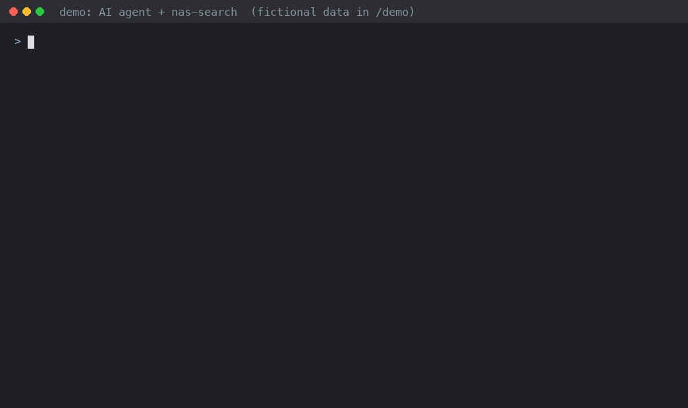
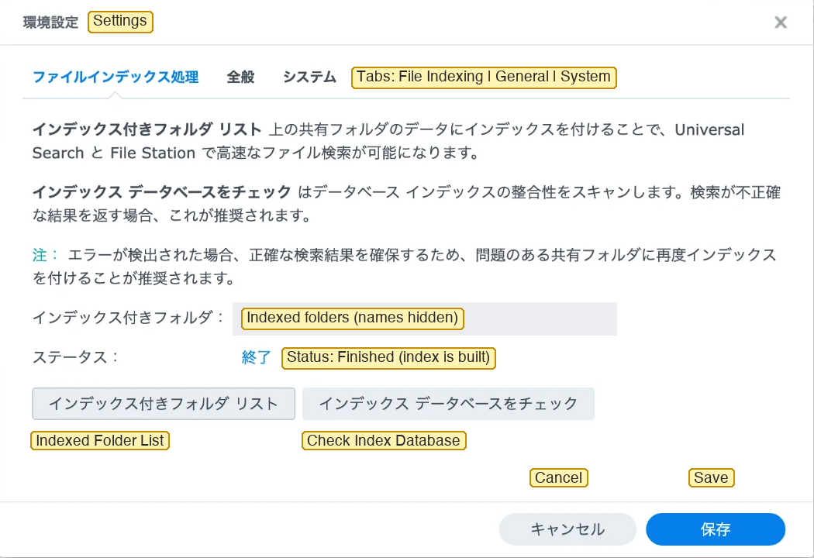

# synology-search-agent-cli

[日本語](README.md) | English

A small CLI that searches the **existing Universal Search index** (full text) of a Synology NAS over SSH and returns JSON. It is built for AI agents.

- **No sudo, no root.** It runs as a normal DSM user.
- **Two-factor authentication (OTP) stays on.** It never turns it off.
- **Read-only.** It never changes files, the index or shared folders.
- Runs on the Python 3.8+ standard library only (no extra packages).



> [!WARNING]
> This tool uses a Web API that Synology does not publish (`SYNO.Finder.FileIndexing.Search`). A DSM update may break it without notice. This is an unofficial tool and is not affiliated with Synology. Synology, DSM and Universal Search are trademarks of Synology Inc.

> [!NOTE]
> The detailed documents under `docs/` are in Japanese. Messages printed by the commands are in Japanese by default; put `lang = en` in the settings files for English (see [Settings files](#settings-files)). Agents should rely on the JSON fields (`error.type`) and exit codes, which are stable and documented below.

## Why

`find` and `grep` walk the files on every search. A file-name search can be fast enough, but a full-text search over a large share is not practical. Synology Universal Search already keeps an index that includes file contents, but there is no public way to use it from a program.

This tool does not build a new index. It **lets an AI agent use the Universal Search index that already exists.** The agent gets only short candidates (name, path, size, date) and opens only the files it needs. It hands the agent the ability to search, and nothing else: no root, no sudo, no shell.

The idea that this API can be called came from [atkaper/synology-universal-search-cli](https://github.com/atkaper/synology-universal-search-cli) (2021). No code from that project is used here (it has no license); only the fact that the API exists and can be called.

The background story (in Japanese) is in [docs/background.md](docs/background.md).

## Tested environment

- Synology DS225+, DSM 7.4.1 (build 90080), Python 3.8.15 on the NAS
- Status: beta. A search session was checked to keep working for about 25 hours (not yet to the end of 90 days). Other models and DSM versions are not verified yet
- What was checked on the device: [docs/verification.md](docs/verification.md) (Japanese)

On other models and DSM versions, run `--check-api` first to see whether the API is there.

## How it fits together

```
AI agent ──ssh (search-only key)──▶ NAS: unisearch --agent-gateway
  nas-search                                │ (UNIX socket)
                                            ▼
                               search session (started by a person with OTP)
                                            │
                                            ▼
                               DSM Web API (127.0.0.1:5001)
```

| File | Role |
|---|---|
| [`unisearch`](unisearch) | Runs on the NAS. Interactive search, the search session, and the SSH entry point |
| [`clients/nas-search`](clients/nas-search) | Runs on the agent's machine. Builds the ssh call and returns the result |
| [`skills/nas-search/SKILL.md`](skills/nas-search/SKILL.md) | Instructions for agents (Claude Code skill format) |
| [`scripts/remote-run.sh`](scripts/remote-run.sh) | Try the CLI without placing any file on the NAS |

## Before you start (on the NAS)

1. **Make the NAS reachable from the agent over SSH.** The author uses [Tailscale](https://tailscale.com/) and does not expose the NAS to the internet. The tool itself does not need Tailscale; any SSH path works. Do not expose the NAS's SSH port to the internet.
2. **Check the API.** After placing the CLI on the NAS (step 1 of [docs/agent-setup.md](docs/agent-setup.md)), run `~/.local/bin/unisearch --check-api` on the NAS. No login is needed. It returns `"ok": true` when the needed APIs exist in a supported version. It does not check the contents of the index or whether a search works.
3. **Check Universal Search (if `--check-api` fails).** On DSM 7, Universal Search is normally preinstalled as a built-in package that cannot be removed from Package Center. Synology does not officially state that it is present on every model, though. Look for "Universal Search" in Package Center → Installed and make sure it is running. If it is missing, install it from Package Center.
4. **Choose the shared folders to index.** In Universal Search, open settings (gear icon, top right) → File Indexing → Indexed Folder List, and add the folders you want to search. **If you add none, no index is built and searches return nothing.** Synology's help says files in folders that are not indexed do not appear in results, and that folders used through File Station or SMB must be added by hand ([File Indexing](https://kb.synology.com/en-global/DSM/help/SynoFinder/universalsearch_index?version=7)). To search inside documents, choose "File content indexing".

   

   The screenshot is from a Japanese DSM; the yellow English labels were added. The text in the middle says that the folders in Indexed Folder List are indexed for Universal Search and File Station, and that Check Index Database scans the index when search results look wrong.
5. **Create a search-only DSM account.** Not an administrator, with two-factor authentication, and with read access only to the shared folders you want searched. Be careful with `homes`: if the account can read it, every user's home folder shows up in results.
6. **Try a search.** Use the interactive search in [Usage](#usage) step 1 and check that files in the indexed folders are found.

A result of 0 hits in a folder that is not indexed does not mean the file is not there. External USB/SD drives, remote folders and cloud folders are not searched by Universal Search ([Universal Search](https://kb.synology.com/en-global/DSM/help/SynoFinder/universalsearch_overview?version=7)).

> [!NOTE]
> Universal Search 2.0 (June 2026) is currently available only on some high-end models ([Release Notes](https://www.synology.com/en-global/releaseNote/SynoFinder)). This tool has not been tested with 2.0.

> [!NOTE]
> The command is named `unisearch`. Up to v0.6 it was `synosearch`, which clashed with DSM's own `/usr/syno/bin/synosearch` (an unrelated help-search command), so it was renamed.

## Usage

### 1. Interactive search (for people)

```bash
ssh -t <ssh-user>@<nas-host> '~/.local/bin/unisearch "test" --limit 5'
ssh -t <ssh-user>@<nas-host> '~/.local/bin/unisearch "test" --limit 20 --json'
```

You type the DSM user name, password and OTP in the terminal. Each run logs in and logs out.

### 2. From an AI agent

1. A person starts a search session on the NAS and types the password and OTP. The session lasts 8 hours by default (1 minute to 90 days). When it ends, a person starts it again. DSM kept the login alive for about 25 hours in our test; longer periods are not verified yet.
2. The agent calls `nas-search "<query>"` with its search-only SSH key. No password or OTP is needed.

```bash
nas-search "test" --limit 20
nas-search --status
```

Setup steps are in [docs/agent-setup.md](docs/agent-setup.md) (Japanese; the commands in it can be used as they are).

### Output

One JSON line on stdout:

```json
{"schema_version": 1, "query": "test", "offset": 0, "limit": 20, "total": null,
 "returned": 20, "next_offset": 20, "has_error": false, "unavailable": null,
 "hits": [{"name": "test.pdf", "share_path": "/archive/Drive/test.pdf",
           "path": "/volume1/archive/Drive/test.pdf", "extension": "pdf",
           "size": 12345, "is_dir": false, "modified": 1396685721,
           "modified_utc": "2014-04-05T08:15:21Z", "readable": true}]}
```

- `total` is always `null` when results are limited to allowed folders, so the number of out-of-scope hits is never revealed. Use `next_offset` (not `null`) to tell whether more results exist.
- Pages are consistent while the index does not change. If files are added or removed between pages, a page can repeat or skip results (on the device, deleting files shown on an earlier page skipped the same number of later results). Deduplicate by `share_path`.

Errors are one JSON line on stderr: `{"error": {"type", "message", "exit_code"}}`.

| Exit code | Meaning |
|---|---|
| 0 | Success (0 hits is possible) |
| 1 | Unexpected internal error (`internal`) |
| 2 | Usage or settings error (`usage`, `config`) |
| 3 | Login failed (`auth`, interactive search) |
| 4 | Search API error (`api`), or `scan_limit` (too many out-of-scope results; call again to continue) |
| 5 | Connection failed or no response in time (`network` on the NAS, `ssh` from `nas-search`) |
| 6 | Unexpected response format (`response`; the API may have changed) |
| 7 | No terminal for interactive input (`no_tty`) |
| 8 | No search session, or it has ended (`session_required`): ask a person to start one |
| 9 | A search session is already running (`session_running`), or the state folder is wrong (`state`) |
| 130 | Interrupted with Ctrl-C (`interrupted`) |

The full specification (options, fields, exit codes, settings) is in [docs/cli-spec.md](docs/cli-spec.md) (Japanese).

## Security design

- Passwords, OTPs and SIDs are never written to files or logs. The SID lives only in the memory of the search session.
- Only the owner can talk to the search session: a UNIX socket with mode 0600.
- The agent's key is limited by `restrict,command=` in `authorized_keys`. It can only search: no shell, no port forwarding.
- The search scope is limited twice. The main guard is DSM's shared-folder permissions; the CLI's `--allow-prefix` is a second layer. When results are limited, the out-of-scope count is not shown.
- Use a search-only DSM account (not an administrator, with two-factor authentication).

The design discussion (Japanese) is in [docs/design-noninteractive-auth.md](docs/design-noninteractive-auth.md).

## Settings files

Timing values can be changed in settings files. Order of precedence: command-line options > settings file > defaults. Safety limits (for example, a session lasts at most 90 days) are fixed in the code. Passwords, OTPs and SIDs cannot be written in settings files.

| Where | File | Main settings |
|---|---|---|
| NAS | `~/.config/unisearch/server.conf` | Session length, keepalive, timeouts, language |
| Agent's machine | `~/.config/unisearch/client.conf` | Host, key, wait time, language |

For English messages, write `lang = en` in both files (on the agent's machine, `UNISEARCH_LANG=en` also works). Messages from a search session that is already running stay in the language it started with. JSON keys, `error.type` and exit codes are the same in every language.

> [!NOTE]
> TLS certificate checks are skipped only because the target is the NAS itself (`127.0.0.1`). Do not point it at a remote URL.

## Tests

The tests use only the standard library and do not need a NAS.

```bash
python3 -m unittest discover -s tests -v
```

The steps for checking on a real NAS are in [docs/nas-verification.md](docs/nas-verification.md) (Japanese).

## See also

- [atkaper/synology-universal-search-cli](https://github.com/atkaper/synology-universal-search-cli): an earlier command-line tool that calls the Universal Search API from a shell. It is what started this project.

## Changes and security

- Changelog: [CHANGELOG.md](CHANGELOG.md)
- Reporting security problems: [SECURITY.md](SECURITY.md)

## License

[MIT](LICENSE)
