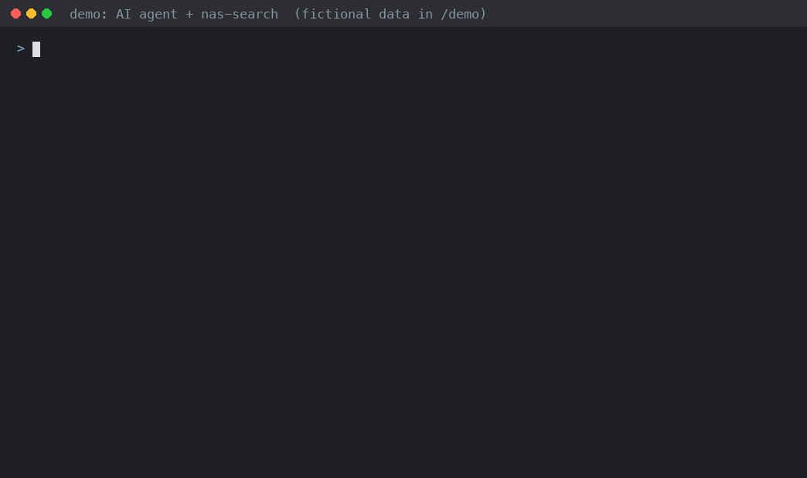
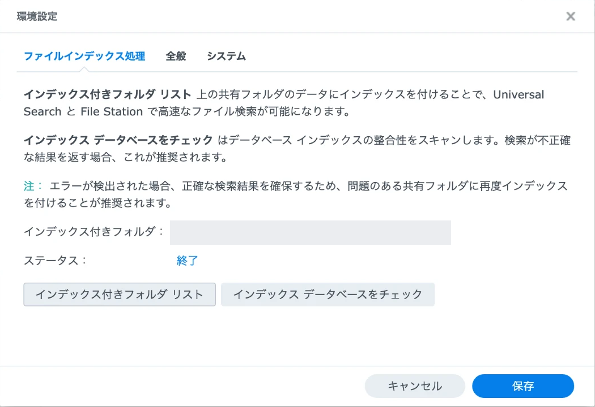

# synology-search-agent-cli

日本語 | [English](README.en.md)

Synology NAS の **Universal Search（全文検索）の既存インデックス**を、SSH から検索して JSON で受け取るための小さな CLI です。AI エージェントから使うことを想定しています。

- **sudo 不要・root 不要**。DSM の一般ユーザーとして動きます
- **2段階認証（OTP）はそのまま**。外しません
- **読み取り専用**。ファイル・インデックス・共有フォルダは変更しません
- Python 3.8 以上の標準ライブラリだけで動きます（追加パッケージ不要）



> [!WARNING]
> Synology が公開していない Web API（`SYNO.Finder.FileIndexing.Search`）を使っています。DSM の更新で予告なく動かなくなる可能性があります。Synology 社とは関係のない非公式ツールです。Synology、DSM、Universal Search は Synology Inc. の商標です。

## なぜ作ったか

`find` や `grep` は、検索のたびにファイルを走査します。ファイル名だけなら速いこともありますが、本文の検索はデータが大きいと使えません。Synology の Universal Search は、本文まで含めた索引をすでに作っています。ところが、それをプログラムから使う公開された入口がありません。

このツールは、新しく索引を作るのではなく、**すでにある Universal Search の索引を AI エージェントから使えるようにします**。エージェントは名前・パス・更新日などの候補だけを受け取り、必要なファイルだけを開きます。root や sudo を渡さず、検索だけを渡すように作っています。

この API を呼び出せることは、[atkaper/synology-universal-search-cli](https://github.com/atkaper/synology-universal-search-cli)（2021年）で知りました。このリポジトリは、あちらのコードを使っていません（あちらにはライセンスが付いていないため）。参考にしたのは、API があって呼び出せるという点だけです。

くわしい経緯は [docs/background.md](docs/background.md) にあります。

## 動作確認済みの環境

- Synology DS225+、DSM 7.4.1（build 90080）、NAS 側 Python 3.8.15
- 状態: β版。8時間以上の連続運用や、他の機種での動作は未確認
- 確認した内容は [docs/verification.md](docs/verification.md)

他の機種・DSM バージョンでは未確認です。まず `--check-api` で API があるか確かめてください。

## 構成

```
AIエージェント ──ssh（検索専用の鍵）──▶ NAS: unisearch --agent-gateway
   nas-search                                   │（UNIXソケット）
                                                ▼
                                     検索セッション（本人が OTP で開始）
                                                │
                                                ▼
                                     DSM Web API（127.0.0.1:5001）
```

| ファイル | 役割 |
|---|---|
| [`unisearch`](unisearch) | NAS 上で動く本体。対話検索、検索セッション、SSH 入口 |
| [`clients/nas-search`](clients/nas-search) | エージェント側のコマンド。ssh を組み立てて結果を返す |
| [`skills/nas-search/SKILL.md`](skills/nas-search/SKILL.md) | エージェント向けの説明書（Claude Code のスキル形式、英語。答えはユーザーの言語で返すよう書いてある） |
| [`scripts/remote-run.sh`](scripts/remote-run.sh) | NAS にファイルを置かずに試すためのスクリプト |

## 使う前の準備（NAS 側）

1. **エージェントから NAS に SSH で届くようにする。** 作者は [Tailscale](https://tailscale.com/) を使い、NAS をインターネットに公開していません（[背景編の0章](docs/background.md#0-前提エージェントから-nas-に届く道)）
2. **API が使えるか確かめる。** CLI を NAS に置いたあと（[導入手順](docs/agent-setup.md)の1）、NAS の上で `~/.local/bin/unisearch --check-api` を実行します。ログインは要りません。必要な API があって、対応するバージョンなら `"ok": true` が返ります。索引の中身や、検索が実際にできるかまでは確かめません
3. **Universal Search を確かめる（`--check-api` が失敗したとき）。** DSM 7 では、Universal Search は通常、最初から入っています。DSM 7 の標準の機能で、パッケージセンターからは削除できないパッケージとして扱われています。ただし、すべての機種で必ず入っていると、公式に書かれてはいません。DSM の「パッケージセンター」→「インストール済み」に「Universal Search」があるか、止まっていないかを見てください。無ければパッケージセンターからインストールします
4. **索引を作る共有フォルダを指定する。** Universal Search の設定（右上の歯車）→「ファイルインデックス処理」（英語の画面では File Indexing）→「インデックス付きフォルダ リスト」（Indexed Folder List）で、検索させたいフォルダを追加します。**指定しないと索引は作られず、検索しても何も返りません。** Synology の公式ヘルプでも、索引を作っていないフォルダのファイルは結果に出ず、File Station や SMB で使うフォルダは自分で追加する必要があるとされています（[File Indexing](https://kb.synology.com/en-global/DSM/help/SynoFinder/universalsearch_index?version=7)）。本文まで検索するには、方法に「File content indexing」を選びます

   

   「インデックス付きフォルダ」に、索引を作る共有フォルダが並びます（画像では伏せています）。「ステータス」が「終了」なら、索引はできあがっています。
5. **検索専用の DSM アカウントを作る。** 管理者にしない、2段階認証をかける、検索させたい共有フォルダだけを読めるようにします。`homes` を読めるようにすると、全員のホームフォルダが結果に出るので注意してください

6. **実際に検索してみる。** [使い方](#使い方)の1の対話検索で、索引を作ったフォルダのファイルが見つかるか確かめます

索引の対象外のフォルダでは、0件でも「ファイルがない」とは言えません。外付けの USB・SD、リモートのフォルダ、クラウドのフォルダは、Universal Search の検索の対象になりません（[Universal Search](https://kb.synology.com/en-global/DSM/help/SynoFinder/universalsearch_overview?version=7)）。

> [!NOTE]
> Universal Search 2.0（2026年6月）は、今のところ一部の上位機種だけに入れられます（[Release Notes](https://www.synology.com/en-global/releaseNote/SynoFinder)）。このツールは 2.0 では試していません。

> [!NOTE]
> このツールのコマンド名は `unisearch` です。v0.6 までは `synosearch` でしたが、DSM にもとからある `/usr/syno/bin/synosearch`（ヘルプを検索する別のコマンド）と同じ名前だったので変えました。

## 使い方

### 1. 対話で検索する（人が使う）

```bash
ssh -t <ssh-user>@<nas-host> '~/.local/bin/unisearch "test" --limit 5'
ssh -t <ssh-user>@<nas-host> '~/.local/bin/unisearch "test" --limit 20 --json'
```

ユーザー名・DSM パスワード・OTP を端末から入力します。毎回ログインしてログアウトします。

### 2. AI エージェントから使う

1. 人が NAS で検索セッションを始める（パスワードと OTP を入力）。期限は既定 8 時間（1分〜90日で指定可）。期限が切れたら、また人が始め直す。24時間を超える期間で DSM 側のログインがもつかは未確認です
2. エージェントは検索専用の SSH 鍵で `nas-search "検索語"` を呼ぶ。パスワードも OTP も不要

```bash
nas-search "test" --limit 20
nas-search --status
```

導入手順は [docs/agent-setup.md](docs/agent-setup.md) にあります。

## 安全のための設計

- パスワード・OTP・SID はファイルにもログにも残しません。SID は検索セッションのメモリの中だけに置きます
- 検索セッションへの接続は、本人だけが読めるソケット（0600）からに限ります
- エージェント用の鍵は `authorized_keys` の `restrict,command=` で検索しかできません。シェル・ポート転送は使えません
- 検索範囲は二重に絞ります。主な守りは DSM の共有フォルダ権限で、CLI の `--allow-prefix` は補助です。絞り込み時は範囲外の件数を結果に出しません
- 検索専用の DSM アカウント（管理者でない・2段階認証あり）を使うことを推奨します

詳しい検討は [docs/design-noninteractive-auth.md](docs/design-noninteractive-auth.md) にあります。

## 設定ファイル

時間などの動作の値は、設定ファイルで変えられます。優先順は「コマンドライン引数 ＞ 設定ファイル ＞ 既定値」です。安全に関わる上限（有効期間は最大90日など）はコードで固定しています。パスワード・OTP・SID は設定ファイルに書けません。

| 場所 | ファイル | 主な設定 |
|---|---|---|
| NAS | `~/.config/unisearch/server.conf` | セッションの有効期間・keepalive・各タイムアウト |
| エージェント側 | `~/.config/unisearch/client.conf` | 接続先・鍵・待ち時間 |

一覧は [docs/cli-spec.md](docs/cli-spec.md) の「設定ファイル」にあります。

> [!NOTE]
> TLS 証明書の検証は、接続先が NAS 自身（`127.0.0.1`）の場合に限って省いています。リモートの URL に変えて使わないでください。

## 仕様とテスト

- オプション・JSON の形式・終了コード: [docs/cli-spec.md](docs/cli-spec.md)
- 実機での確認手順: [docs/nas-verification.md](docs/nas-verification.md)

テストは標準ライブラリだけで動きます。NAS は要りません。

```bash
python3 -m unittest discover -s tests -v
```

## 参考

- [atkaper/synology-universal-search-cli](https://github.com/atkaper/synology-universal-search-cli)：Universal Search の API をシェルから呼ぶ、先に作られた例。このツールのきっかけです

## 変更履歴とセキュリティ

- 変更履歴: [CHANGELOG.md](CHANGELOG.md)（英語）
- セキュリティの問題の知らせ方: [SECURITY.md](SECURITY.md)

## ライセンス

[MIT](LICENSE)
